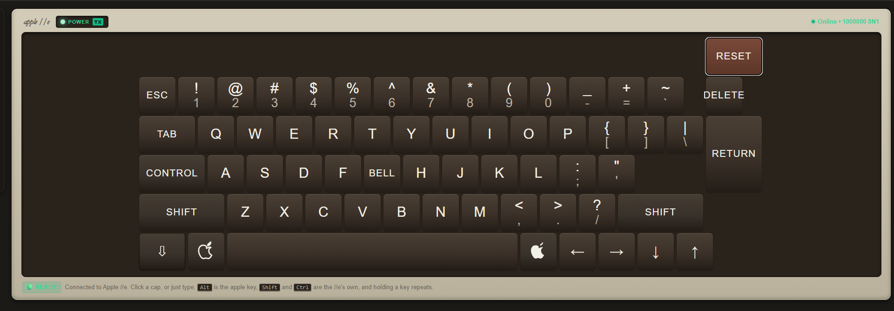
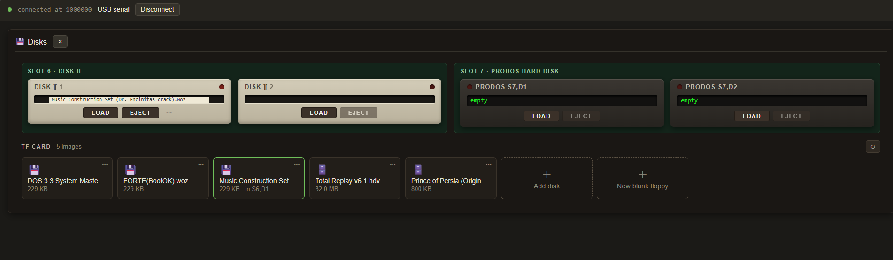
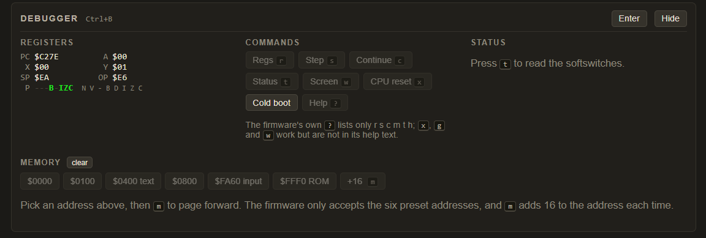

# Apple //e on Tang Primer 20K

A complete, cycle-accurate implementation of the **Apple //e Enhanced** computer in Verilog for the [Sipeed Tang Primer 20K](https://wiki.sipeed.com/hardware/en/tang/tang-primer-20k/primer-20k.html) (Gowin GW2A-LV18PG256C8/I7) on its Dock board.

> 🌐 **Live Web Console & Companion App:** [https://terenceang.github.io/apple2e_TP20K/](https://terenceang.github.io/apple2e_TP20K/)  
> Connect directly to your Tang Primer 20K over USB-C Web Serial (Chrome or Edge) for keyboard input, screen display, floppy/hard disk image mounting, and hardware debugging with zero software installs. You can use the live GitHub Pages app, run your own local server (`http://localhost:5273`), or host it anywhere on any static web host.

The design runs as a self-contained system with digital video and audio over HDMI, stereo analog headphone audio, dual Disk II floppy drives, a ProDOS SmartPort hard disk, CP/M support, modem communications, and a browser-based Web Serial companion interface.

---

## Web Companion Interface

The companion web application connects directly to the Tang Primer 20K over USB-C Web Serial (1,000,000 baud 8N1) with zero software installs:

| **Virtual Keyboard & Gamepad** | **Storage & Disk Manager** | **Hardware Debugger & Live Screen Capture** |
| :---: | :---: | :---: |
| [](Documents/images/keyboard.png) | [](Documents/images/storage.png) | [](Documents/images/debugger.png) |
| Authentic Apple //e keyboard, modifier keys, virtual joystick & live status flags | Dual Disk II & SmartPort mounting, live sector traffic & on-the-fly image conversion | 65C02 CPU freeze/step, memory inspector & live Text/Hi-Res/DHGR NTSC screen dump |

---

---

## Features

> [!NOTE]
> **Hardware Testing Status:** The core system, video (Text/Lo-Res/Hi-Res/DHGR), audio (Speaker/Mockingboard), Dual Disk II, ProDOS SmartPort HD, Real-Time Clock, and Web Serial debugger are verified and fully functional. The following three features are implemented in RTL but are currently **untested on hardware**:
> 1. **Direct USB Host Keyboard** (ULPI USB-C `J8`)
> 2. **Super Serial Card (SSC)** (Slot 1)
> 3. **Microsoft Z-80 SoftCard** (Slot 2 / CP/M)

### System Core & Memory
* **65C02 CPU** clocked at an exact, cycle-accurate **1.0227 MHz** (5/132 of the 27 MHz master crystal).
* **128 KB Total RAM**: 48 KB Main RAM and 16 KB System ROM implemented in on-chip Block SRAM; 64 KB Auxiliary RAM (80-column / double hi-res) and Language Card banks ($D000–$FFFF) served from high-speed DDR3.
* **Apple //e MMU & Softswitches**: Complete banking and memory decoding for `80STORE`, `RAMRD`, `RAMWRT`, `ALTZP`, and Language Card read/write controls.

### Display & Video
* **HDMI 720×480p60 Output** (CEA-861 VIC 2) with the active 560×384 Apple raster centered.
* **NTSC Colour Render Engine & Hardware DSP Multiplier**: An Apple //e has no colour memory. Every mode sends one stream of dots at 14.318 MHz, four to a cycle of the colour subcarrier, and the TV reads colour from where in that cycle the lit dots fall. The engine works the same way, with no palette tables:
  * **One dot stream for every mode.** Text, lo-res, double lo-res, hi-res (with the bit-7 half-dot delay) and double hi-res each only produce samples, one per pixel, into a single 8-sample history.
  * **Hardware Multiplier Acceleration.** YIQ-to-RGB matrix conversion and monochrome Lo-Res multi-level luminance scaling are computed using on-chip hardware signed multipliers (`MULT18X18`), saving valuable slice logic on the ~96% utilized FPGA die.
  * **One decoder, modelled on a TV.** Brightness comes from a 4-dot window (the TV's filter that removes the colour carrier); colour from the subcarrier phase of the lit dots. So hi-res fringes, white where dots touch, solid fills from dot patterns and the blue/orange shift of bit 7 all come out of the signal, as on a real machine.
  * **One set of colours.** Lo-res, hi-res and double hi-res share the decode, so lo-res orange is hi-res orange, as on a //e. Double hi-res sits one dot later against the subcarrier (nibble *v* shows as lo-res colour ROL1(*v*), Apple's DHGR table, checked against AppleWin), and double lo-res aux blocks follow the same rule.
  * **Pinned to the //e's colours.** `tb_video_hdmi` checks every mode pixel for pixel against independent models, and holds all colours to a literal 16-colour table, so the RTL and its model cannot drift together.
* **All Video Modes Supported**:
  * 40-Column & 80-Column Text (with MouseText and alternate character set support)
  * Lo-Res and Double Lo-Res (80-column lo-res) Graphics
  * Hi-Res and Double Hi-Res Graphics (560×192, 16 colors)
  * Mixed Graphics/Text and Page 1 / Page 2 flipping (80STORE respected)
* **Monitor Display Modes (DIP 4 & 5)**:
  * `00` (**Color Mode**): Full NTSC artifact color decoding. DIP 1 selects between Sharp RGB Monitor (ideal 4-tap box filter, green text) and Composite Color TV (8-tap weighted analog filter with authentic color bleeding and fringes). Alternating 14 MHz dots in 80-column text retain full 100% modulation contrast in both settings.
  * `01` (**Monochrome Green**): P31 green phosphor (`#20E820`), emulating Apple Monitor // and Monitor ///. Bypasses NTSC chroma demodulation so 560×192 Double Hi-Res graphics (GEOS, desktop publishing) render as crisp 1-bit monochrome pixels without color fringes.
  * `10` (**Monochrome Amber**): P134 amber phosphor (`#FFA000`), emulating the Apple Monitor //c CRT.
  * `11` (**Monochrome White**): Paper-white phosphor (`#F0F0F0`) for high-contrast composite monochrome display.
* **Color TV Mode (DIP 1)**: The same decoder with a TV's narrow colour filter: colour is read over 8 dots (weighted 1-2-3-4-4-3-2-1) instead of 4, so colour bleeds across edges and fringes blend while brightness detail stays sharp. Solid colours are identical with it on or off, and the picture does not move. It also adds the set's colour killer: in TEXT mode a //e sends no colour burst, so text is white with no colour, while mixed-mode text lines fringe as they did on a real TV. Off: an ideal monitor with sharp colour and green text.
* **CRT Scanlines (DIP 2 & 3)**: Selectable line darkening (Off, 25%, 50%, 75%) of the second copy of each doubled Apple line, in every mode.
* **Full-Range RGB**: Declares full-range color (0–255) in the AVI InfoFrame so modern TVs and monitors do not crush deep blacks.

### Sound Subsystem
* **Speaker**: Standard 1-bit toggle speaker at `$C030`.
* **Mockingboard C (Slot 4)**: Dual 6522 VIAs driving two AY-3-8910 programmable sound generators (6 audio channels) for rich stereo game music and sound effects.
* **Clean 48 kHz Digital Pipeline**: Piecewise second-order CIC integrator and 47-tap halfband FIR decimator ensure crystal-clear audio with zero aliasing artifacts from high AY frequencies.
* **Simultaneous Audio Outputs**: Stereo audio streams over both **HDMI audio data islands** and the Dock's **3.5 mm jack** via the onboard PT8211 16-bit DAC.

### Storage & Expansion Slots
* **Slot 6 — Dual Disk II Controller**:
  * Reads and writes authentic [WOZ 1](https://applesaucefdc.com/woz/reference1/) and [WOZ 2](https://applesaucefdc.com/woz/reference2/) bitstream images byte-for-byte from the TF card.
  * Cycle-synced sequencer controller with an MC3470 read amplifier model handles 13-sector disks, standard 16-sector disks, quarter-tracks, fast loaders (e.g. French Touch's 8-cycle page-crossing poll), and copy-protected originals.
  * Fractional-rate NCO bit cell timing with spindle speed scaling and hardware DSP acceleration for track indexing.
  * Modified floppy sectors are automatically synced back to the TF card image ~1 second after drive activity ceases.
* **Slot 7 — ProDOS Block Device & SmartPort**:
  * Provides two 32 MB hard disk volumes (`.hdv` or `.po` raw block format) streaming on demand from the TF card.
  * Answers as both a ProDOS block driver and an Apple SmartPort device.
* **Slot 5 — Real-Time Clock**:
  * Thunderclock-compatible hardware clock; files saved under ProDOS receive live timestamps.
* **Slot 2 — Microsoft Z-80 SoftCard** *(Implemented, Untested)*:
  * Hardware Z80 CPU running at 2.045 MHz for running CP/M 2.2 and CP/M applications.
* **Slot 1 — Super Serial Card (SSC)** *(Implemented, Untested)*:
  * Full 6551 ACIA-compatible serial interface connected to the host USB link; supports virtual Hayes modem emulation via the web interface.

### Keyboard & Input
* **Direct USB Keyboard (Dock USB-C J8)** *(Implemented, Untested)*: Plug any standard USB keyboard directly into the second USB-C port (`J8`). The built-in hardware ULPI USB host controller interfaces with the onboard Microchip USB3317 PHY, auto-enumerates HID boot keyboards, translates scancodes directly to Apple //e ASCII characters, maps modifier keys (Left Alt / Windows key = Open-Apple, Right Alt = Closed-Apple), and routes `Ctrl` + `Alt` + `Del` directly to the Apple //e Reset line.
* **Web Serial Console & Virtual Input**: Connect directly via Chrome or Edge at 1,000,000 baud 8N1 — provides virtual keyboard, paddle button controls, and analog joystick emulation with no background daemons, drivers, or software installs required.
* **Disk Manager**: Live mounting, blank disk creation, and on-the-fly conversion of `.dsk`, `.do`, `.po`, and `.nib` images to `.woz`.
* **Hardware Debugger & Screen Capture**: Built-in serial debugger allows freezing the CPU at any instant to inspect registers, single-step instructions, examine RAM, and capture the live framebuffer (Text, Lo-Res, Mixed, 280×192 Hi-Res, and 560×192 Double Hi-Res graphics in authentic NTSC composite color) directly into the browser companion.

---

## Hardware Controls & Indicators

### Dock Switches & Buttons

| Control | Function | Description |
|---|---|---|
| **Button S0 (Key 1)** | System Reset | Resets the Apple //e and reloads card configuration. |
| **Button S1 (Key 2)** | HDMI Test Pattern | Overrides display with SMPTE color bars and 1 kHz tone (bypasses core for display diagnostics). |
| **DIP Switch 1** | Color TV Mode | **ON**: Composite colour TV: colour bleeds and fringes blend (detail stays sharp), white text with no colour in TEXT mode. **OFF**: Ideal monitor: sharp colour, green text. Solid colours are the same either way. |
| **DIP Switch 2 & 3** | Scanline Intensity | Sets scanline darkening: `00` = Off, `01` = 25%, `10` = 50%, `11` = 75%. |
| **DIP Switch 4 & 5** | Monitor Display Mode | Selects phosphor/color mode: `00` = Color (DIP 1), `01` = Monochrome Green (P31), `10` = Monochrome Amber (P134), `11` = Monochrome White (B&W). In monochrome modes, chroma demodulation is bypassed for razor-sharp 560×192 DHGR graphics without rainbow fringes. |

### Status LEDs

| LED | Indicator | Meaning |
|---|---|---|
| **LED 0** | Heartbeat | Toggles every 16 frames (~1.9 Hz) driven by vertical blanking. |
| **LED 1** | Hardware Ready | Illuminates solid when PLLs are locked and DDR3 is calibrated. |
| **LED 2** | Running | Active when CPU is out of reset. |
| **LED 3** | Memory Write | Pulses during CPU write cycles. |
| **LED 4** | Text Mode | Active when the display is in 40- or 80-column text mode. |
| **LED 5** | Keyboard Strobe | Illuminates when an unread keystroke is waiting in `$C000`. |

---

## Keyboard Shortcuts & Control Sequences

| Shortcut / Sequence | Target | Action |
|---|---|---|
| `Ctrl` + `Reset` | Apple //e | Standard **Warm Restart** (preserves memory / soft switches). |
| `Ctrl` + `Open-Apple` + `Reset` | Apple //e | Full **Cold Boot** (re-initializes memory and boots drives). |
| `Ctrl` + `Open-Apple` + `Closed-Apple` + `Reset` | Apple //e | Enters **ROM Diagnostic Self-Test** (see quirks below). |
| `Ctrl` + `B` | Serial Link | Toggles the **Hardware Debugger** (freezes/unfreezes CPU). |
| `Esc` then `4` | 80-Column Firmware | Switches active display to 40-column text. |
| `Esc` then `8` | 80-Column Firmware | Switches active display to 80-column text. |
| `PR#6` | Applesoft BASIC | Re-executes the Slot 6 Disk II bootloader. |
| `PR#7` | Applesoft BASIC | Re-executes the Slot 7 ProDOS hard drive bootloader. |
| `PR#1` | Applesoft BASIC | Initializes the Slot 1 Super Serial Card. |

---

## Authentic Hardware Behaviors & Operational Notes

These are not FPGA anomalies—they are the **exact, authentic behaviors of original Apple //e hardware and firmware**:

1. **Hardware Reset Gating (Requires `Ctrl`)**:
   On the Apple II and II+, users frequently complained about accidentally hitting the top-right `RESET` key while typing. On the Apple //e, Apple redesigned the keyboard encoder circuit so the physical `RESET` line is electrically gated through the `CONTROL` key. `Reset` alone does nothing by design.
2. **Expansion Slot Boot Priority (Slot 7 over Slot 6)**:
   The official Apple Autostart ROM scans expansion slots in descending order from Slot 7 down to Slot 1. Because hard disk controllers are traditionally placed in Slot 7 and Disk II floppy controllers in Slot 6, the system always boots the hard drive first if an image is attached. To boot floppy disks instead, type `PR#6` from the Applesoft BASIC prompt (`]`), or configure Slot 7 Drive 1 as empty.
3. **Diagnostic Self-Test Sample Timing**:
   The Apple //e Enhanced ROM samples the paddle buttons ($C061 and $C062) at reset release. To enter the self-test, release `Reset` while keeping `Open-Apple` and `Closed-Apple` depressed for a moment so the reset vector reads them before the slot scan begins.
4. **Firmware Burn-In / Soak Test**:
   The self-test routine inside Apple's Enhanced CD/EF ROM explicitly checks at address `$C794` whether both Apple buttons are still held down. If so, it branches directly back to `$C600` to repeat the test indefinitely. This was Apple's intentional factory and service bench soak test. Releasing the keys lets the pass conclude with `System OK`.
5. **TF Card Requirements**:
   * Must be formatted as **FAT32** (32 GB or smaller recommended).
   * Disk images must be stored contiguously in the root directory.
   * `A2CONFIG.TXT` in the card root specifies drive mappings using 8.3 filenames (e.g., `S6D1=DOS33.WOZ`, `S7D1=TOTAL.HDV`).
6. **Debugger Freeze Mode**:
   Pressing `Ctrl+B` pauses CPU clocking entirely. Video display refresh and audio clocks continue running normally, allowing inspection of video memory and registers without racing against software loops.

---

## Hardware Debugger Commands

When paused in debugger mode (`Ctrl+B` or via serial):

| Command | Action | Description |
|---|---|---|
| `r` | Registers | Dumps `PC`, `A`, `X`, `Y`, `SP`, `P` flags, and next instruction opcode. |
| `s` | Step | Single-steps the 65C02 by one instruction. |
| `c` | Continue | Resumes normal CPU execution and returns to console mode. |
| `m` | Memory Dump | Dumps 16 bytes of memory (subsequent `m` commands page forward). |
| `@hhhh` | Set Address | Sets the active memory dump pointer (e.g. `@0400` or `@c0f0`). |
| `0`, `1`, `4`, `8`, `f`, `v` | Quick Address | Jump presets for `$0000`, `$0100`, `$0400`, `$0800`, `$FA60`, and `$FFF0`. |
| `w` | Screen Dump | Captures the displayed framebuffer: 1 KB text/lo-res page ($0400/$0800), 8 KB hi-res page ($2000/$4000), plus the aux half when active (8 KB for Double Hi-Res, the 1 KB text page for Double Lo-Res). With 80STORE on it dumps the page on screen, not the one PAGE2 selects for writing. |
| `t` | Diagnostic Status | Displays video mode (`VID:T`/`VID:G`), PLL lock status, and DDR3 calibration. |
| `i` | Drive Info | Displays Disk II head track (`H:hh`) and TF card status word (`S:ssss`). |
| `y1`–`y4` | Reload Drive | Hot-reloads drive image 1–4 from `A2CONFIG.TXT` on the TF card. |
| `x` | CPU Reset | Triggers a hardware reset of the CPU while retaining the debugger pause. |

---

## Quick Start & Usage

### 1. Requirements
* [Sipeed Tang Primer 20K](https://wiki.sipeed.com/hardware/en/tang/tang-primer-20k/primer-20k.html) with Dock baseboard.
* MicroSD (TF) card formatted as **FAT32**.
* Gowin EDA 1.9.12.04 (for bitstream generation).
* Apple //e ROM files (see [`roms/README.md`](roms/README.md)).

### 2. Building the Bitstream
```powershell
# Synthesize, place & route, and generate bitstream:
make

# Fast load directly into SRAM (volatile):
make flash-sram

# Program into external SPI flash (persistent across power-cycles):
make flash
```

### 3. Web Companion Interface

The web companion is a 100% client-side web application that directly connects to the Tang Primer 20K over the browser's Web Serial API. You have three flexible ways to run or host it:

* **Option A: GitHub Pages (Instant, Zero Setup)**
  * **Live Hosted Version:** Open [https://terenceang.github.io/apple2e_TP20K/](https://terenceang.github.io/apple2e_TP20K/) in Chrome or Edge, click **Connect USB**, and pick the Dock's USB serial port.
  * **Your Own Fork:** To publish on your own GitHub Pages, run `cd web && npm run pages`, commit the `docs/` folder, and enable Pages in GitHub (**Settings → Pages → Deploy from branch** `main` → `/docs`).

* **Option B: Run Locally on Localhost**
  You can run your own local development or preview server on the machine your Tang Primer 20K is plugged into:
  ```bash
  cd web
  npm install

  # Launch local development server (runs at http://localhost:5273/):
  npm run dev

  # Or build and serve the production bundle:
  npm run build
  npm run preview         # or: python3 -m http.server -d dist 8000
  ```

* **Option C: Self-Host Anywhere (Static Web Hosting)**
  * Because the companion compiles into pure static HTML/CSS/JavaScript without any backend server or daemon requirements, you can host the output of `web/dist/` on **any web server or static hosting platform** (e.g. Cloudflare Pages, Netlify, Vercel, AWS S3, Apache, or Nginx).
  * **Security Requirement:** Modern web browsers require a **Secure Context** to grant Web Serial access. Ensure your self-hosted domain is served over `https://` (or `http://localhost` for local testing).

#### Web Companion Gallery
| Virtual Keyboard & Gamepad | Storage & Disk Manager | Hardware Debugger & Live Screen Capture |
| :---: | :---: | :---: |
|  |  |  |

---

## Project Structure

```
src/top.v               Top-level integration, clocks, HDMI serializers, DDR3 & TF wiring
src/apple2_core.v       65C02 CPU integration, bus multiplexing, softswitches, language card
src/apple2_mem.v        BSRAM memory buffers for main 48 KB RAM and 16 KB system ROM
src/aux_ram.v           Auxiliary 64 KB RAM, language card, Disk II & hard-disk buffer in DDR3
src/video_generator.v   Apple display generator and the NTSC colour render engine (all modes)
src/hdmi/               HDMI transmitter: TMDS encoders, data islands, audio/AVI InfoFrames
src/sound_generator.v   Speaker logic and Mockingboard audio mixing to the PT8211 DAC
src/audio_filter.v      48 kHz resampler (CIC in DSP blocks, 47-tap halfband FIR filter)
src/mockingboard/       Mockingboard C implementation (dual 6522 VIAs + dual AY-3-8910 PSGs)
src/disk2/              Disk II controller, sequencer, and WOZ2 bitstream replay engine
src/prodos_hd.v         ProDOS block device and Apple SmartPort hard drive controller
src/prodos_hd_rom.s     SmartPort firmware assembly source
src/thunderclock.v      Thunderclock-compatible real-time clock card (Slot 5)
src/softcard.v          Microsoft Z-80 SoftCard implementation (Slot 2)
src/ssc.v               Super Serial Card with virtual modem pipeline (Slot 1)
src/sd_vol.v            FAT32 TF card interface, block caching, and auto write-back
src/input_controller.v  1 Mbps serial RX, keyboard latch, gamepad & paddle decoding
src/serial_debugger.v   1 Mbps serial TX, console mirror, and hardware debugger
src/cpu/                65C02 processor core
constraints/top.cst     Tang Primer 20K Dock pin assignments
web/                    Browser front-end (React, TypeScript, Web Serial)
web/src/ntsc.js         The page's copy of the colour render engine, matching the HDMI output
scripts/                Build, programming, and diagnostic utility scripts
```

---

## Credits & Third-Party Components

* **6502 / 65C02 Processor Core**: Arlet Ottens ([verilog-6502](https://github.com/Arlet/verilog-6502)) with 65C02 extensions by David Banks and Ed Spittles ([hoglet67/verilog-6502](https://github.com/hoglet67/verilog-6502)).
* **Z80 Processor Core**: Guy Hutchison ([hutch31/tv80](https://github.com/hutch31/tv80)), based on Daniel Wallner's original T80.
* **DDR3 Memory Controller IP**: Gowin Semiconductor / Sipeed BSD-3-Clause TangPrimer-20K-example.
* **HDMI Transmitter Core**: Based on the TN20K-HDMI project (MIT License).
* **Apple //e System Firmware & ROMs**: © Apple Computer, Inc. (ROM files are not included in this repository; users must provide their own dumps per legal guidelines).

---

## License

[MIT](LICENSE) © 2026 Terence Ang
